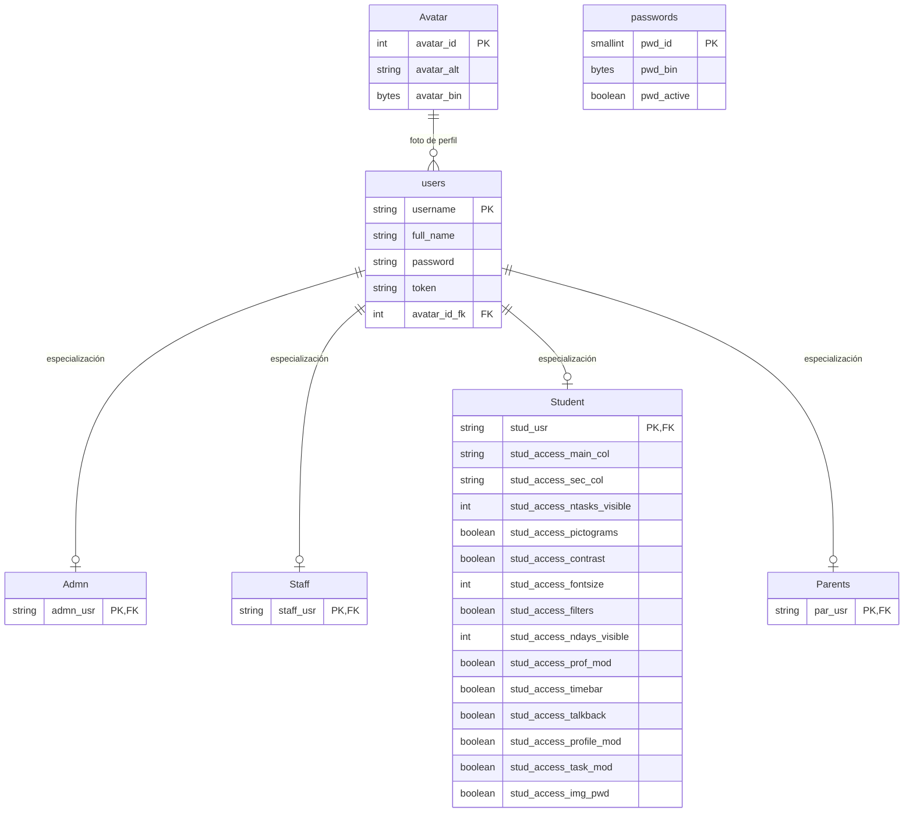

# Modelo relacional de cuentas y perfiles

La foto de perfil pertenece a la entidad común `users`. Las especializaciones de rol heredan esa propiedad al referenciar `users.username`.

`users.avatar_id_fk` es obligatorio y referencia `Avatar.avatar_id`. En cada alta se crea una silueta predeterminada. Al cambiar la foto se actualiza la referencia común y se retira la imagen anterior cuando ninguna cuenta la usa. Cada cuenta pertenece a una especialización de rol; solo `Student` añade los campos de accesibilidad.

`passwords` es un catálogo independiente de imágenes para el inicio gráfico del alumnado; no guarda contraseñas ni una relación por usuario. `pwd_id` identifica la imagen que el cliente muestra y envía como parte de la secuencia de acceso. La secuencia se hashea y se almacena en `users.password`, igual que las credenciales de texto. `Student.stud_access_img_pwd` activa este modo solo para la cuenta del alumno. `pwd_active` permite retirar una imagen de nuevas selecciones sin eliminar IDs que ya forman parte de contraseñas existentes.

## Acceso a las fotos

La API autoriza cada consulta con las relaciones existentes, sin añadir tablas. Antes del inicio de sesión, se pueden consultar únicamente fotos del alumnado matriculado para que cada estudiante elija su perfil en el acceso visual:

- Un alumno puede ver a los alumnos de sus clases, a los tutores asociados a su cuenta y al personal asignado a esas clases.
- Un tutor puede ver a sus alumnos asociados y al personal que enseña en alguna clase de esos alumnos.
- Un miembro del personal puede ver a los alumnos de las clases que imparte.
- Un administrador puede ver la foto de cualquier cuenta; cada usuario también puede consultar la propia.

Los tutores pueden ver la foto del profesorado de sus hijos para poder identificarlo. Sin sesión no se pueden consultar fotos de personal, familias o administradores, ni de alumnos no matriculados.

Para una base nueva, la definición vigente está en [CreacionTablas.sqlscript](CreacionTablas.sqlscript). 
