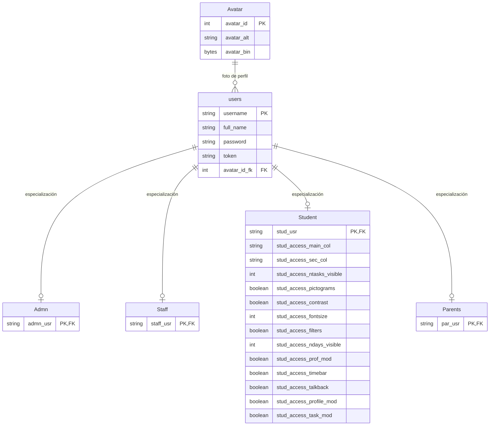

# Modelo relacional de cuentas y perfiles

La foto de perfil pertenece a la entidad común `users`. Las especializaciones de rol heredan esa propiedad al referenciar `users.username`.

`users.avatar_id_fk` es obligatorio y referencia `Avatar.avatar_id`. En cada alta se crea una silueta predeterminada. Al cambiar la foto se actualiza la referencia común y se retira la imagen anterior cuando ninguna cuenta la usa. Cada cuenta pertenece a una especialización de rol; solo `Student` añade los campos de accesibilidad.

Para una base nueva, la definición vigente está en [CreacionTablas.sqlscript](CreacionTablas.sqlscript). 
