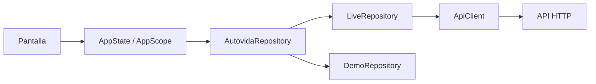
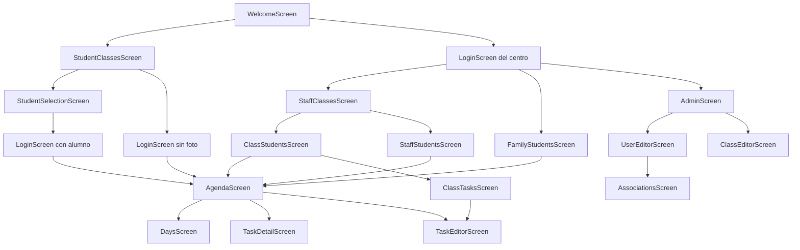
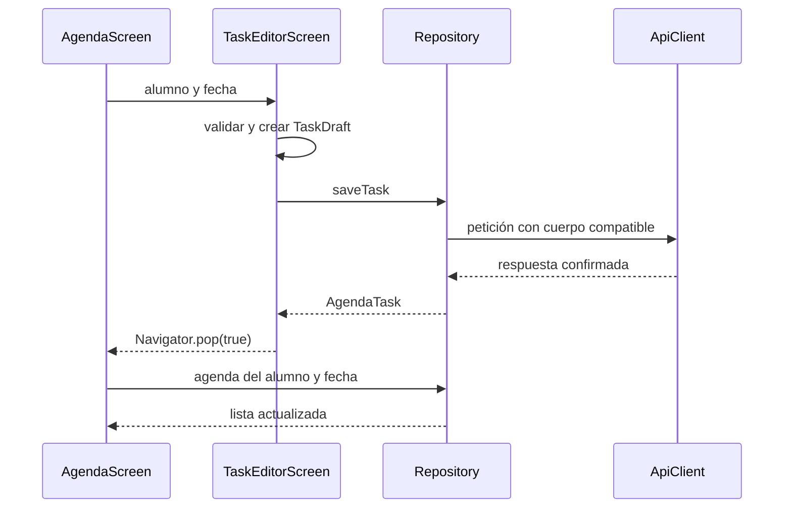

# AUTOVIDA: guía técnica del frontend

**Rama:** `iteracion1` · **Revisión:** 11/11/2026 · **Referencia de código:** `0aaf9f1`

Documento de incorporación y mantenimiento de la aplicación Flutter. Describe la organización del proyecto, el funcionamiento de sus componentes principales, el flujo de información entre pantallas y las pruebas de desarrollo. La integración con el backend se limita a las peticiones HTTP utilizadas por el frontend.

La preparación del entorno, el uso del lanzador y la resolución de errores están en la [guía de ejecución](../ejecucion/GUIA_EJECUCION.md).

Las rutas de archivos indicadas como código parten de la raíz del repositorio. Los comandos especifican cuándo deben ejecutarse dentro de `src/frontend`.

## Índice

1. [Alcance funcional](#1-alcance-funcional)
2. [Jerarquía del proyecto Flutter](#2-jerarquía-del-proyecto-flutter)
3. [Arquitectura y ciclo de ejecución](#3-arquitectura-y-ciclo-de-ejecución)
4. [Modelos y transformación de datos](#4-modelos-y-transformación-de-datos)
5. [Interfaz y componentes compartidos](#5-interfaz-y-componentes-compartidos)
6. [Integración HTTP utilizada por el frontend](#6-integración-http-utilizada-por-el-frontend)
7. [Navegación y flujo entre pantallas](#7-navegación-y-flujo-entre-pantallas)
8. [Actualización de datos y persistencia](#8-actualización-de-datos-y-persistencia)
9. [Pruebas y mantenimiento](#9-pruebas-y-mantenimiento)

## 1. Alcance funcional

AUTOVIDA es una agenda accesible con cuatro perfiles. El rol de la sesión determina la pantalla inicial y las operaciones disponibles.

| Perfil | Valor en el código | Pantalla inicial | Funciones |
| --- | --- | --- | --- |
| Alumno | `UserRole.student` | `AgendaScreen` | Consultar su agenda y gestionar tareas propias si tiene permiso. |
| Personal | `UserRole.staff` | `StaffClassesScreen` | Consultar aulas y alumnos asociados, gestionar tareas y retirar alumnos ya matriculados. |
| Familia | `UserRole.parent` | `FamilyStudentsScreen` | Consultar alumnos vinculados y gestionar sus tareas. |
| Administración | `UserRole.admin` | `AdminScreen` | Gestionar cuentas, preferencias, fotos, aulas y asociaciones. |

El alta de alumnos en un aula está reservada a administración en el frontend. Personal no dispone de controles de alta; la capa de datos del cliente también bloquea esa operación.

La aplicación admite datos reales mediante `LiveRepository` y datos de demostración mediante `DemoRepository`. Las pantallas comparten el mismo contrato de repositorio y no realizan peticiones HTTP directamente.

El recorrido de tareas de esta iteración trabaja con una tarea como unidad. Los modelos de pasos y el temporizador se conservan como utilidades de compatibilidad, pero no hay una pantalla activa de ejecución por pasos.

## 2. Jerarquía del proyecto Flutter

### 2.1. Organización general

```text
src/frontend/
├── pubspec.yaml                  Identidad, SDK y dependencias declaradas
├── pubspec.lock                  Versiones resueltas de las dependencias
├── analysis_options.yaml        Configuración del analizador y linter
├── .metadata                    Metadatos de plataformas de Flutter
├── .gitignore                   Exclusión de artefactos locales
├── lib/                         Código Dart de la aplicación
├── test/                        Pruebas unitarias, HTTP y de widgets
├── linux/                       Integración nativa GTK/CMake
├── android/                     Integración Android/Kotlin/Gradle
├── web/                         Contenedor web e iconos
├── README.md                    Entrada a la documentación
└── NOTAS_INTEGRACION_MAIN.md     Decisiones y límites de integración
```

Esta guía se encuentra en `docs/explicacion frontend/GUIA_FRONTEND.md`, fuera del proyecto Flutter.

`lib/` contiene la lógica compartida entre plataformas. Las carpetas `linux/`, `android/` y `web/` aportan el contenedor nativo, permisos y recursos de cada destino; no duplican las pantallas Dart.

`build/`, `.dart_tool/`, los directorios `ephemeral` y los archivos `generated_*` se regeneran durante la resolución de dependencias o la compilación. No son el origen de la interfaz. Este checkout no incluye contenedores iOS, macOS o Windows.

### 2.2. Árbol del código Dart

```text
lib/
├── main.dart
├── app.dart
├── models/
│   ├── domain.dart
│   ├── student_search.dart
│   ├── task_timer.dart
│   └── validation.dart
├── services/
│   ├── api_client.dart
│   ├── repository.dart
│   └── demo_repository.dart
├── state/
│   └── app_state.dart
├── screens/
│   ├── welcome_screen.dart
│   ├── login_screen.dart
│   ├── student_classes_screen.dart
│   ├── staff_classes_screen.dart
│   ├── staff_students_screen.dart
│   ├── student_grid.dart
│   ├── class_students_screen.dart
│   ├── class_tasks_screen.dart
│   ├── agenda_screen.dart
│   ├── days_screen.dart
│   ├── task_detail_screen.dart
│   ├── task_editor_screen.dart
│   ├── admin_screen.dart
│   ├── user_editor_screen.dart
│   ├── class_editor_screen.dart
│   ├── associations_screen.dart
│   ├── settings_screen.dart
│   └── access_editor.dart
└── ui/
    ├── ui.dart
    ├── routes.dart
    ├── theme.dart
    └── widgets/
        ├── action_tile.dart
        ├── app_footer.dart
        ├── brand.dart
        ├── content_picture.dart
        ├── form_actions.dart
        ├── icon_action.dart
        ├── load_panel.dart
        ├── notice.dart
        ├── page_shell.dart
        ├── paged_items.dart
        ├── section_title.dart
        ├── speech_button.dart
        ├── status_badge.dart
        ├── student_picker.dart
        ├── task_badges.dart
        └── user_avatar.dart
```

| Directorio | Responsabilidad | Dependencias habituales |
| --- | --- | --- |
| `models` | Representación, conversión y validación de datos. | Dart; utilidades puntuales de Flutter para el temporizador. |
| `services` | Contrato de acceso a datos, implementación HTTP y demostración. | Modelos, `http`, `shared_preferences`. |
| `state` | Sesión compartida, repositorio activo y notificaciones. | Modelos, servicios, `ChangeNotifier`. |
| `screens` | Composición de cada recorrido, formularios y estado local. | Modelos, `AppScope`, componentes de `ui`. |
| `ui` | Navegación, tema y controles reutilizables. | Flutter; algunos componentes acceden al estado o a plugins. |

La separación es funcional: una pantalla organiza una acción, el repositorio resuelve cómo obtener o guardar sus datos y el modelo define su representación. El proyecto no utiliza BLoC, Riverpod ni una capa de controladores generados.

### 2.3. Contenedores de plataforma

| Ubicación | Contenido significativo |
| --- | --- |
| `linux/CMakeLists.txt` | Nombre del binario, dependencias GTK y composición del bundle. |
| `linux/runner/main.cc` | Entrada nativa que crea la aplicación GTK. |
| `linux/runner/my_application.cc` | Ventana, tamaño inicial 1280 × 900, vista Flutter y registro de plugins. |
| `linux/flutter/` | Integración de compilación y registro generado de plugins. |
| `android/app/build.gradle.kts` | Identificador `es.clench.autovida`, SDK, destino Java 17 y configuración de compilación. |
| `android/settings.gradle.kts` | Plugins de Gradle y localización del SDK Flutter. |
| `android/app/src/main/AndroidManifest.xml` | Permiso de Internet, actividad principal y consulta del servicio TTS. |
| `android/app/src/debug/` y `profile/` | Permiso de tráfico HTTP en esas modalidades. |
| `android/app/src/main/kotlin/.../MainActivity.kt` | Actividad nativa que hereda de `FlutterActivity`. |
| `web/index.html` | Documento en español y carga de `flutter_bootstrap.js`. |
| `web/manifest.json` | Nombre, icono y presentación de la aplicación web. |

La configuración Android de release conserva firma de debug. La existencia de la carpeta no equivale a un paquete de producción validado.

Las fotos de alumnos y las imágenes de contenido llegan como datos, no como rutas a recursos locales de Flutter. El `pubspec.yaml` actual no declara una carpeta de assets Dart; los iconos del contenedor web o Android se configuran en sus respectivas plataformas.

### 2.4. Dependencias

| Paquete | Uso |
| --- | --- |
| `flutter`, `flutter_localizations` | Widgets Material y localización de la interfaz. |
| `http` | Peticiones, respuestas y subida multipart. |
| `intl` | Presentación de fechas y horas. |
| `flutter_svg` | Representación de fotos SVG predeterminadas. |
| `file_selector` | Selección de imágenes desde administración. |
| `flutter_tts` | Lectura en voz alta mediante `SpeechButton`. |
| `shared_preferences` | Persistencia local de caché y operaciones pendientes. |
| `cupertino_icons` | Biblioteca de iconos declarada como dependencia. |
| `flutter_test`, `flutter_lints` | Pruebas y análisis estático. |

El YAML declara el rango permitido de versiones y el lock conserva la resolución usada por la aplicación. Una actualización de plugins puede requerir recompilación nativa y comprobación de cada plataforma.

## 3. Arquitectura y ciclo de ejecución

### 3.1. Punto de entrada y composición de la aplicación

[main.dart](../../src/frontend/lib/main.dart) inicializa Flutter y monta el widget raíz:

```dart
void main() {
  WidgetsFlutterBinding.ensureInitialized();
  runApp(const AutovidaApp());
}
```

[app.dart](../../src/frontend/lib/app.dart) contiene `AutovidaApp` y su estado. Sus responsabilidades son crear o recibir `AppState`, seleccionar el inicio por rol, configurar español como idioma y aplicar tema y escala de texto.

El inicio depende de la sesión, no de una ruta de texto:

```dart
Widget get _inicio => switch (state.user?.role) {
  null => const WelcomeScreen(),
  UserRole.student => AgendaScreen(student: state.user!),
  UserRole.staff => const StaffClassesScreen(),
  UserRole.parent => const FamilyStudentsScreen(),
  UserRole.admin => const AdminScreen(),
};
```

La aplicación admite un `AppState` inyectado. Si lo recibe, no asume su propiedad ni lo libera al destruirse; si lo crea internamente, también lo destruye. Este criterio permite probar las mismas pantallas con repositorios controlados.

### 3.2. Árbol de widgets principal

```text
AutovidaApp
└── AppScope
    └── AnimatedBuilder, suscrito a AppState
        └── MaterialApp, clave sessionVersion
            └── Pantalla inicial según el rol
                └── PageShell
                    ├── Bandas de estado, si corresponden
                    ├── Cabecera
                    ├── Contenido de la pantalla
                    └── AppFooter, cuando la pantalla lo incorpora
```

`AppScope` publica el estado mediante `InheritedNotifier<AppState>`. `AppScope.of(context)` devuelve la instancia compartida y registra la dependencia del widget. No crea otra sesión ni otro repositorio.

`AnimatedBuilder` escucha las notificaciones de `AppState` y reconstruye `MaterialApp`. Mientras se conserva su clave, Flutter mantiene el estado de navegación correspondiente. Cambiar `sessionVersion` cambia esa identidad y descarta la pila de la sesión anterior.

### 3.3. Capas de ejecución



`AppState` es el punto de acceso compartido, pero no envuelve todas las operaciones. Autenticación y refresco de perfil pasan por sus métodos; una pantalla puede llamar a `state.repository.saveTask(...)` para una operación de dominio. La comunicación HTTP sigue concentrada en los servicios.

### 3.4. Estado global

[state/app_state.dart](../../src/frontend/lib/state/app_state.dart) define `AppState`, que hereda de `ChangeNotifier`.

| Miembro | Función |
| --- | --- |
| `repository` | Implementación de datos activa. |
| `user` | Usuario autenticado y preferencias cargadas. |
| `serverUrl` | URL inicializada mediante `API_BASE_URL`. |
| `student` | Indica si la sesión pertenece a un alumno. |
| `access` | Preferencias del usuario o valores predeterminados sin sesión. |
| `canEditOwnSettings` | Control de acceso a los ajustes propios. |
| `sessionVersion` | Identidad de la sesión y su navegación. |
| `avatarVersion` | Invalida la imagen cargada por `UserAvatar`. |
| `classroomVersion` | Invalida listas y contadores de aulas. |

El login actualiza el usuario después de completar la operación del repositorio:

```dart
Future<void> login(String username, String password, UserRole role) async {
  user = await repository.login(username, password, role);
  notifyListeners();
}
```

`LiveRepository.login()` obtiene el token, descubre capacidades, carga el perfil completo y prepara la caché de alumno. Solo entonces entrega el usuario a `AppState`. La notificación permite seleccionar el inicio y aplicar sus preferencias.

`expire()` elimina el usuario, incrementa `sessionVersion` y notifica. `logout()` espera al repositorio y limpia la sesión cuando este confirma que ya no tiene usuario. `setDemo()` y `setServer()` sustituyen el repositorio y reinician la sesión.

El estado mantiene además un temporizador de 15 segundos para intentar enviar operaciones pendientes. `dispose()` cancela ese temporizador y cierra el repositorio.

### 3.5. Estado local y ciclo de vida de las pantallas

Las búsquedas, fechas, filtros, controladores de formulario, mensajes y estados de espera viven en el `State` de cada pantalla. No se almacenan globalmente porque pertenecen a una instancia del recorrido.

| Método | Uso en el proyecto |
| --- | --- |
| `initState()` | Inicializar campos desde parámetros y crear la primera petición de un cargador. |
| `didChangeDependencies()` | Inicializar datos que necesitan `AppScope`; por ejemplo, copiar ajustes o comprobar la versión de una foto. |
| `didUpdateWidget()` | Reaccionar a un parámetro distinto sobre el mismo estado; `UserAvatar` vuelve a cargar si cambia el usuario. |
| `build()` | Construir widgets a partir del estado. |
| `dispose()` | Liberar controladores, temporizadores, cliente de datos o lectura de voz. |

Después de una operación asíncrona, las pantallas comprueban `mounted` antes de actualizar estado o navegar. El usuario puede haber cerrado la ruta mientras se esperaba una respuesta.

`setState()` actualiza una pantalla. `notifyListeners()` informa a los consumidores del estado global. Repetir una consulta requiere, además, revisar cómo se conserva su `Future`.

## 4. Modelos y transformación de datos

### 4.1. Modelo de dominio

[models/domain.dart](../../src/frontend/lib/models/domain.dart) reúne los objetos compartidos:

| Tipo | Contenido | Uso principal |
| --- | --- | --- |
| `Json` | Alias de `Map<String, dynamic>`. | Intercambio con la capa HTTP. |
| `UserRole` | Rol técnico y etiquetas visibles. | Inicio, permisos y selección de rutas. |
| `AppUser` | Usuario, nombre, rol, correo, URL de foto y accesibilidad. | Sesión, listas, editores y destinatario de agenda. |
| `AccessSettings` | Preferencias `stud_access_*`. | Tema, presentación y permisos de alumno. |
| `Classroom` | Nombre, alumnos, personal y metadatos de completitud/recuento. | Gestión y navegación por aulas. |
| `AgendaTask` | Datos de tarea, asignación por fecha, autor y estado. | Agenda, detalle y edición grupal. |
| `TaskDraft` | Datos preparados por el editor para guardar. | Serialización de una operación de escritura. |
| `TaskStep` | Contenido y estado de pasos, cuando existen. | Compatibilidad y descripción de tareas. |

`fromJson()` adapta los nombres de intercambio a propiedades Dart. `toJson()` serializa el objeto completo cuando procede. `TaskDraft.toApiJson()` genera específicamente el cuerpo de guardado, que no equivale al JSON completo de una tarea leída.

### 4.2. Usuario y preferencias

`AppUser.fromJson()` convierte `full_name` en `fullName`, toma el rol de la respuesta o del argumento explícito y recopila los campos de accesibilidad conocidos. Cuando una lista omite el rol, el repositorio pasa el rol que corresponde a esa consulta.

`AccessSettings` combina valores predeterminados con los recibidos. Los accesores construyen el nombre de intercambio:

```dart
bool flag(String key) => values['stud_access_$key'] == true;
int number(String key) => (values['stud_access_$key'] as num).toInt();
String color(String key) => values['stud_access_$key'] as String;
AccessSettings copy() => AccessSettings(toJson());
```

Un formulario edita una copia. Así, escribir o pulsar un interruptor no modifica la sesión compartida antes de guardar. En `SettingsScreen` se conserva otra copia inicial para enviar únicamente diferencias.

### 4.3. Aulas: total y completitud son datos distintos

`Classroom.studentCount` utiliza el total recibido cuando existe y, en otro caso, la longitud de la lista:

```dart
int get studentCount => _studentCount ?? students.length;
```

`staffComplete` indica si la lista de personal es completa. Una lista vacía y una lista que no se ha podido recuperar no significan lo mismo. Las tarjetas de administración solo presentan el contador de personal cuando esa información se considera completa.

### 4.4. Tareas y cuerpos de guardado

`AgendaTask` conserva identificador, fecha de asignación, orden, hora, duración, creador, estado y aula de origen opcional. La pareja tarea/fecha es necesaria para consultar o retirar asignaciones individuales.

`TaskDraft` se construye desde los campos del editor. Un cuerpo básico enviado por el cliente tiene este formato:

```json
{
  "task_title": "Preparar la mochila",
  "task_date": "2026-11-11",
  "task_start_hour": "09:00:00",
  "task_duration": 15,
  "alt_task_id_fk": null
}
```

El borrador puede generar contenido en `steps` a partir de la descripción. `LiveRepository.saveTask()` elimina ese campo cuando la API no lo admite; el editor también oculta entonces la descripción. En la interfaz actual no se editan los pasos por separado.

Las fechas se serializan con `isoDate()` como `AAAA-MM-DD`; las horas se envían como `HH:mm:ss`.

### 4.5. Validación y utilidades

| Archivo | Responsabilidad |
| --- | --- |
| `validation.dart` | Campos obligatorios, usuario, nombre, correo, contraseña, enteros y horario. |
| `student_search.dart` | Filtrado por nombre/usuario sin distinguir mayúsculas ni tildes. |
| `task_timer.dart` | Temporizador con pausa, reanudación y cálculo por tiempo transcurrido; sin pantalla activa en esta iteración. |

`passwordError()` cuenta bytes UTF-8, con máximo de 72, sin recortar espacios de la contraseña. El editor de usuarios exige cifras `0–9` para contraseñas nuevas o modificadas de alumnos, por su acceso con dibujos.

`scheduleError()` valida la duración completa: personal entre 09:00 y 15:00; familia y alumnado fuera de ese intervalo o sin hora fija. Estas reglas se aplican también en fin de semana.

## 5. Interfaz y componentes compartidos

### 5.1. Tema y escalado

[ui/theme.dart](../../src/frontend/lib/ui/theme.dart) concentra la identidad visual:

- `Paleta`: colores de fondo, superficie, texto, estados y controles.
- `Medidas`: tamaños, radios, trazos y ancho máximo del contenido.
- `appTheme()`: configura Material 3, tipografía y estilos de formularios, botones, tarjetas, diálogos y listas.

El tema propio del alumno utiliza sus colores y contraste. La escala de letra se calcula en `app.dart`:

```dart
final factorDelPerfil = state.student
    ? (state.access.number('fontsize') / 16).clamp(1.0, 2.5)
    : 1.0;
```

Este factor se multiplica por la escala del sistema en un `MediaQuery`. Ver la agenda de un alumno desde una sesión de personal no cambia el rol ni aplica automáticamente todo el tema del alumno al resto de la aplicación.

### 5.2. Estructura común de pantalla

`PageShell` construye una `Scaffold` con `SafeArea`, bandas de estado, cabecera y contenido desplazable. Mantiene el contenido centrado cuando cabe y permite desplazamiento cuando el tamaño de pantalla o la escala de texto lo requieren. El pie se añade explícitamente mediante `footer`.

Una pantalla de consulta suele seguir esta composición:

```dart
PageShell(
  title: 'Mis aulas',
  footer: const AppFooter(),
  child: LoadPanel<List<Classroom>>(
    key: ValueKey(state.classroomVersion),
    load: state.repository.classes,
    builder: (aulas) => PagedItems<Classroom>(
      items: aulas,
      builder: (aula) => Text(aula.name),
    ),
  ),
)
```

El ejemplo muestra el patrón de composición. Cada pantalla incorpora sus tarjetas, filtros y claves concretas.

### 5.3. Carga asíncrona: `LoadPanel`

`LoadPanel<T>` recibe una función `load` y una función `builder`. Conserva la petición en su estado:

```dart
late Future<T> peticion;

@override
void initState() {
  super.initState();
  peticion = widget.load();
}

void reintentar() => setState(() => peticion = widget.load());
```

Un `FutureBuilder` presenta espera, error con reintento o el contenido. Mantener el `Future` evita repetir la consulta en cada reconstrucción. Como consecuencia, cambiar la función `load` sobre el mismo widget no repite automáticamente la petición: para una recarga se cambia su clave o se solicita reintento.

### 5.4. Paginación y búsqueda

`PagedItems<T>` pagina una colección ya cargada. Calcula el número de páginas, limita el índice si cambia el tamaño y dibuja lista o rejilla. No solicita páginas a la API.

Las flechas se sitúan a los lados con ancho suficiente y debajo en pantallas estrechas. Si solo existe una página, no se muestran controles de navegación.

`StaffStudentsScreen` aplica `filterStudents()` antes de construir la lista y usa el texto de búsqueda como clave del contenedor. Cambiar el criterio vuelve a la primera página sin perder resultados que antes estuvieran en páginas posteriores.

### 5.5. Catálogo de componentes

| Archivo | Función |
| --- | --- |
| `action_tile.dart` | Ficha navegable horizontal o vertical, con icono/foto y acción secundaria opcional. |
| `app_footer.dart` | Inicio, ajustes permitidos y cierre de sesión. |
| `brand.dart` | Marca visual compartida. |
| `content_picture.dart` | Imagen o icono de una tarea; `taskIcon()` selecciona icono según el título. |
| `form_actions.dart` | Acciones guardar/cancelar y diálogo `confirmDelete()`. |
| `icon_action.dart` | Acción compacta con etiqueta accesible. |
| `load_panel.dart` | Resolución visual de una petición asíncrona. |
| `notice.dart` | Aviso informativo/error con región semántica activa. |
| `page_shell.dart` | Estructura de pantalla y banda de sincronización. |
| `paged_items.dart` | Lista o rejilla paginada localmente. |
| `section_title.dart` | Encabezado de sección. |
| `speech_button.dart` | Lectura TTS en español y mensaje si la plataforma no ofrece voz. |
| `status_badge.dart` | Insignias de estado y rol. |
| `student_picker.dart` | Selector reutilizable preparado para búsqueda y selección; no se monta en la vista actual de personal. |
| `task_badges.dart` | Composición de insignias de tarea. |
| `user_avatar.dart` | Carga y representación de foto, SVG o silueta alternativa. |

`ui/ui.dart` reexporta navegación, tema y componentes para simplificar las importaciones de las pantallas.

### 5.6. Ajustes, fotos y accesibilidad

| Ajuste `stud_access_*` | Aplicación en el cliente |
| --- | --- |
| `main_col`, `sec_col`, `contrast` | Colores y contraste de la sesión de alumno. |
| `fontsize` | Escala de texto. |
| `ntasks_visible` | Cantidad de tareas por página; cero muestra todas. |
| `ndays_visible` | Selección de días; cero oculta el acceso a elegir día en la agenda propia. |
| `pictograms` | Apoyos visuales de tareas. |
| `filters` | Filtros de estado en agenda propia. |
| `talkback` | Botones de lectura de texto. |
| `profile_mod` | Acceso y edición de ajustes propios. |
| `task_mod` | Creación y eliminación de tareas propias. |
| `prof_mod`, `timebar` | Se conservan en el modelo; sin un recorrido de interfaz específico activo. |

`AccessEditor` modifica la copia de preferencias recibida. Con `permissions: true`, incorpora los interruptores administrativos. El alumno no recibe esos controles ni campos para cambiar contraseña o foto en sus ajustes.

`UserAvatar` carga mediante el repositorio y conserva el `Future` de imagen. Comprueba `avatarVersion` en `didChangeDependencies()` y el usuario en `didUpdateWidget()`. Si falta la foto o falla su carga, representa una silueta. Las imágenes SVG se procesan con `flutter_svg`.

La subida de foto utiliza `file_selector`, limita el tamaño a 5 MB y envía el archivo con multipart. `SpeechButton` utiliza `flutter_tts`, selecciona español y detiene la lectura al destruirse.

Los controles compartidos incorporan tamaños amplios, etiquetas, foco y estados con texto. Las comprobaciones automáticas de accesibilidad cubren casos concretos; la validación con dispositivos de apoyo sigue siendo una actividad separada.

## 6. Integración HTTP utilizada por el frontend

### 6.1. Contrato del repositorio y cliente HTTP

[services/repository.dart](../../src/frontend/lib/services/repository.dart) contiene `AutovidaRepository`, las acciones derivadas y `LiveRepository`. [services/demo_repository.dart](../../src/frontend/lib/services/demo_repository.dart) implementa el mismo contrato con datos en memoria.

`LiveRepository` selecciona rutas, transforma respuestas en modelos y mantiene cachés. [services/api_client.dart](../../src/frontend/lib/services/api_client.dart) prepara peticiones, Bearer, JSON UTF-8, timeout de 20 segundos, respuestas binarias y subida multipart.

La petición utiliza `Accept: application/json`; añade `Content-Type` cuando hay cuerpo JSON y `Authorization` cuando la operación es protegida y existe token. Los identificadores de ruta se codifican mediante `segment()`.

La respuesta normal se interpreta mediante `errorCode` y `details`:

```json
{"errorCode":0,"details":"successful","classes":[]}
```

`ApiException` conserva mensaje, código y estado HTTP. El código 1002 elimina el token y activa `AppState.expire()`. El 1001 se presenta como error de credenciales en el login. Las imágenes se reciben como bytes; OpenAPI no utiliza esa envoltura JSON.

### 6.2. Sesión y detección de capacidades

El login encadena las siguientes operaciones:

1. Obtener el token y el usuario básico.
2. Consultar OpenAPI con `discover()`.
3. Cargar el perfil completo cuando la capacidad está disponible.
4. Preparar la caché correspondiente a la sesión.

`profile()` admite el formato plano actual y una respuesta con `user` anidado:

```dart
final data = await api.request('GET', '/users/me');
return _user = AppUser.fromJson(
  Map<String, dynamic>.from(data['user'] as Map? ?? data),
);
```

`supports()` comprueba método y ruta. `camposDelCuerpo()` revisa las propiedades admitidas por la petición. Las pantallas utilizan capacidades como `supportsTaskContent`, `canReadAgenda`, `canTrackProgress` o `canSetAvatarOf` para presentar acciones compatibles.

### 6.3. Endpoints de sesión y perfil

Las tablas siguientes relacionan las peticiones utilizadas con el método del cliente y el recorrido que las origina. No incluyen el catálogo administrativo completo de la API ni rutas sin uso en las pantallas actuales.

| Método y ruta | Método del cliente | Uso |
| --- | --- | --- |
| `POST /auth/login` | `login()` | Acceso por rol desde `LoginScreen`. |
| `POST /auth/logout` | `logout()` | Salida desde `AppFooter`. |
| `GET /openapi.json` | `discover()` | Detección de capacidades al autenticar. |
| `GET /users/me` | `profile()` | Perfil tras el login y refresco de ajustes. |
| `GET /` | `_synchronize()` | Comprobación de recuperación de conexión; también se utiliza en el diagnóstico del entorno. |

El token permanece en memoria. Reiniciar la aplicación exige autenticar de nuevo. Un cambio de contraseña o de identificador de la cuenta propia puede invalidar la sesión.

### 6.4. Endpoints de usuarios y fotos

| Método y ruta | Método del cliente | Pantalla o componente |
| --- | --- | --- |
| `GET /users` | `users()` | Lista administrativa y selección de asociaciones. |
| `POST /users` | `saveUser()` sin `previous` | Alta desde `UserEditorScreen`. |
| `PUT /users/{role}/{username}` | `saveUser()` con `previous` | Edición administrativa y `SettingsScreen`. |
| `DELETE /users/{role}/{username}` | `deleteUser()` | Eliminación desde `AdminScreen`. |
| `PUT /users/students/{student_username}/avatar` | `uploadAvatarOf()` | Cambio de foto desde `UserEditorScreen`. |
| `GET /users/students/me/avatar` | `avatar()` | Foto propia de la sesión de alumno. |
| `GET /users/students/{student_username}/avatar-image` | `avatar()` | Fotos de selección de alumno o de alumnos consultados. |

La administración usa las operaciones de cuentas y foto ajena. Los ajustes propios envían únicamente los campos permitidos para el usuario autenticado. La subida de foto utiliza `multipart/form-data` con campo `file`.

La carga de fotos ajenas está sujeta a autorización. Una familia autenticada puede recibir un rechazo en esa ruta y el componente mostrará la silueta; esa representación no demuestra que la imagen no exista.

### 6.5. Endpoints de aulas y miembros

| Método y ruta | Método del cliente | Pantalla o recorrido |
| --- | --- | --- |
| `GET /classes` | `directory()`, `classes()`, `unassignedStudents()` | Directorio previo al login, lista de aulas y candidatos administrativos. |
| `GET /classes/{class_name}` | `_aulaPublica()`, `classDetail()` | Selección de alumno, consulta y edición de aula. |
| `POST /classes` | `saveClass()` sin nombre anterior | Crear aula desde administración. |
| `PUT /classes/{current_class_name}` | `saveClass()` con nombre anterior | Renombrar aula. |
| `DELETE /classes/{class_name}` | `deleteClass()` | Eliminar aula desde administración. |
| `POST /classes/{class_name}/staff/{staff_username}` | `addStaff()` | Asignación desde editor de aula o asociaciones. |
| `DELETE /classes/{class_name}/staff/{staff_username}` | `removeStaff()` | Retirada desde editor de aula. |
| `POST /classes/{class_name}/students/{student_username}` | `enroll()` | Alta de alumno desde administración. |
| `DELETE /classes/{class_name}/students/{student_username}` | `enroll(remove: true)` | Retirada desde administración o personal del aula. |

`directory()` consulta aulas y alumnado sin Bearer para el acceso visual. `classes()` utiliza la sesión y obtiene las aulas que esta puede consultar.

El cliente bloquea el alta desde personal antes de enviar la petición. La capacidad `canEnrollStudents` se utiliza también para mostrar la gestión de alumnos existentes; su nombre no debe interpretarse como autorización suficiente para crear una matrícula.

`unassignedStudents()` combina las cuentas y las matrículas para excluir a los alumnos que ya tienen aula. El editor administrativo es su consumidor activo. El personal no utiliza ese selector en su recorrido actual.

### 6.6. Endpoints de asociaciones

| Método y ruta | Método del cliente | Uso |
| --- | --- | --- |
| `GET /student-links/parents/{parent_username}/students` | `linkedStudents()` | Alumnos de una familia. |
| `GET /student-links/staff/{staff_username}/students` | `linkedStudents()` | Alumnos del personal y consulta administrativa de sus asociaciones. |
| `GET /student-links/students/{student_username}` | `parents()`, `_classroomWithStaff()` | Asociaciones del alumno y recuperación del personal del aula. |
| `POST /student-links/students/{student_username}/parents/{parent_username}` | `linkParent()` | Crear asociación familiar desde administración. |
| `DELETE /student-links/students/{student_username}/parents/{parent_username}` | `linkParent(remove: true)` | Retirar asociación familiar. |

La pantalla de asociaciones del personal asigna un aula mediante `addStaff()`. Su lista de alumnos se obtiene después con `linkedStudents()`.

### 6.7. Endpoints de agenda y tareas

| Método y ruta | Método del cliente | Uso |
| --- | --- | --- |
| `GET /student-tasks/me?task_date=AAAA-MM-DD` | `agenda()` | Agenda propia del alumno. |
| `GET /student-tasks/students/{student_username}?task_date=AAAA-MM-DD` | `agenda()` | Agenda del alumno consultada por personal/familia. |
| `POST /student-tasks/me` | `saveTask()` | Nueva tarea propia con permiso. |
| `POST /student-tasks/students/{student_username}` | `saveTask()` | Nueva tarea individual por personal/familia. |
| `DELETE /student-tasks/me/{task_id}?task_date=AAAA-MM-DD` | `deleteTask()` | Eliminar tarea propia permitida. |
| `DELETE /student-tasks/students/{student_username}/{task_id}?task_date=AAAA-MM-DD` | `deleteTask()` | Retirar tarea individual del alumno asociado. |
| `GET /classes/{class_name}/tasks` | `classTasks()` | Listado de tareas grupales. |
| `POST /classes/{class_name}/tasks` | `saveTask(classroom: ...)` | Crear tarea grupal. |
| `PUT /classes/{class_name}/tasks/{task_id}` | `saveTask(classroom: ..., previous: ...)` | Editar tarea grupal. |
| `DELETE /classes/{class_name}/tasks/{task_id}` | `deleteTask(classroom: ...)` | Eliminar tarea grupal. |

Las operaciones individuales incluyen la fecha de asignación cuando se indica. `saveTask()` decide el destino utilizando la sesión, la presencia de `classroom` y la tarea previa.

La pantalla de detalle incorpora además una acción condicional de progreso:

| Método y ruta | Método del cliente | Disponibilidad |
| --- | --- | --- |
| `PATCH /student-tasks/me/{task_id}/progress?task_date=AAAA-MM-DD` | `completeTask()` → `progress()` | Solo se ofrece si la API anuncia la capacidad. No está disponible en la API de referencia. |

Esta condición permite que una misma pantalla funcione con demostración o con una API que admita progreso, sin presentar esa acción en una conexión que no lo soporte.

## 7. Navegación y flujo entre pantallas

### 7.1. Navegación tipada por resultados

[ui/routes.dart](../../src/frontend/lib/ui/routes.dart) utiliza `Navigator` y `MaterialPageRoute`:

```dart
Future<T?> openPage<T>(BuildContext context, Widget page) =>
    Navigator.of(context).push<T>(MaterialPageRoute(builder: (_) => page));

void goHome(BuildContext context) =>
    Navigator.of(context).popUntil((route) => route.isFirst);
```

Los parámetros entran por el constructor del widget. El resultado vuelve mediante `Navigator.pop(context, resultado)`. No se utiliza un router declarativo ni una variable global de alumno seleccionado.

El patrón de apertura de un editor es:

```dart
final guardada = await openPage<bool>(
  context,
  TaskEditorScreen(student: widget.student, date: dia),
);
if (mounted && guardada == true) {
  _recargar(mensaje: 'La tarea se ha guardado.');
}
```

El editor devuelve `true` después de guardar. El cierre mediante «Volver» o «Cancelar» suele devolver `null`. Algunas pantallas recargan con cualquier resultado porque pueden contener acciones ya guardadas antes de cerrarse.

Los identificadores que comienzan por `_` son privados a la biblioteca Dart. Los estados `_...State` y los widgets auxiliares privados agrupan detalles de implementación de la pantalla; no son rutas adicionales.

### 7.2. Mapa de recorridos



`SettingsScreen` se abre desde `AppFooter` cuando la sesión dispone de permiso. Las conexiones del diagrama representan recorridos de usuario; la pantalla inicial después del login la selecciona `app.dart`.

### 7.3. Responsabilidad de cada archivo de pantallas

| Archivo | Clases principales | Entrada y resultado |
| --- | --- | --- |
| `welcome_screen.dart` | `WelcomeScreen` | Abre acceso del alumno o login del centro. |
| `login_screen.dart` | `LoginScreen` | Recibe roles permitidos y alumno opcional; autentica y vuelve al inicio. |
| `student_classes_screen.dart` | `StudentClassesScreen`, `StudentSelectionScreen` | Carga el directorio y pasa el aula y alumno elegidos. |
| `staff_classes_screen.dart` | `StaffClassesScreen` | Lista aulas de la sesión; pasa `className` al detalle. |
| `staff_students_screen.dart` | `StaffStudentsScreen`, `FamilyStudentsScreen` | Obtienen alumnos asociados y los pasan a la agenda. |
| `student_grid.dart` | `StudentGrid` | Presenta alumnos en lista/rejilla y abre su agenda. |
| `class_students_screen.dart` | `ClassStudentsScreen` | Consulta un aula y permite gestionar sus alumnos existentes. |
| `class_tasks_screen.dart` | `ClassTasksScreen` | Recibe `Classroom`, lista tareas grupales y abre el editor. |
| `agenda_screen.dart` | `AgendaScreen` | Recibe `AppUser`; mantiene fecha, filtros y revisión de tareas. |
| `days_screen.dart` | `DaysScreen` | Recibe fecha y devuelve un `DateTime`. |
| `task_detail_screen.dart` | `TaskDetailScreen` | Recibe alumno y tarea; consulta, elimina o registra progreso si está disponible. |
| `task_editor_screen.dart` | `TaskEditorScreen` | Recibe alumno, fecha, tarea opcional y aula opcional; devuelve `true` al guardar/eliminar. |
| `admin_screen.dart` | `AdminScreen` | Alterna usuarios y aulas y abre sus editores. |
| `user_editor_screen.dart` | `UserEditorScreen` | Recibe usuario opcional; crea/edita cuenta, foto y acceso a asociaciones. |
| `class_editor_screen.dart` | `ClassEditorScreen` | Recibe aula opcional; crea/renombra y gestiona sus miembros. |
| `associations_screen.dart` | `AssociationsScreen` | Recibe usuario y guarda asociaciones familiares o asignación a aula. |
| `settings_screen.dart` | `SettingsScreen` | Edita los ajustes propios y actualiza el perfil compartido. |
| `access_editor.dart` | `AccessEditor` | Formulario reutilizable sobre una copia de `AccessSettings`. |

### 7.4. Login visual del alumno

1. `StudentClassesScreen` llama a `directory()` y presenta aulas.
2. La selección pasa un `Classroom` a `StudentSelectionScreen`.
3. La foto pulsada pasa un `AppUser` a `LoginScreen(student: ...)`.
4. Login fija usuario y rol; los dibujos introducen la contraseña numérica.
5. `AppState.login()` recibe el perfil completo del repositorio y notifica.
6. La agenda se convierte en inicio de sesión y `goHome()` retira las pantallas de acceso.

Si no se carga el directorio, se ofrece escribir el nombre de usuario. La contraseña del alumno sigue utilizando dibujos.

La correspondencia cifra/dibujo se define por el orden de `_dibujos` en `login_screen.dart`:

| Cifra | Dibujo | Cifra | Dibujo |
| --- | --- | --- | --- |
| 0 | Sol | 5 | Coche |
| 1 | Corazón | 6 | Pelota |
| 2 | Estrella | 7 | Casa |
| 3 | Animal | 8 | Árbol |
| 4 | Flor | 9 | Música |

El marcador representa la longitud introducida; `_escribir()` añade una cifra y `_borrar()` elimina la última. El orden de la tabla forma parte del significado de las contraseñas existentes.

### 7.5. Sesión autenticada y alumno consultado

`AppState.user` identifica a quien ha iniciado sesión. `widget.student` identifica al destinatario de una agenda. Un miembro del personal puede abrir `AgendaScreen(student: alumno)` manteniendo su propia sesión.

El repositorio utiliza el rol autenticado para elegir entre agenda propia y agenda asociada. Esta distinción debe mantenerse en nuevas pantallas: el rol del destinatario no determina las credenciales de la petición.

`StaffStudentsScreen` y `FamilyStudentsScreen` cargan `linkedStudents()`. `StudentGrid` abre la agenda del alumno pulsado y ejecuta su callback `onReturn` al regresar, cuando la pantalla superior necesita recargar la lista.

### 7.6. Agenda, fecha y tareas

`AgendaScreen` mantiene `dia`, `filtro` y `revision`. La clave de la consulta combina revisión y fecha. El filtro de estado se aplica a la colección recibida y el número de tareas por página depende de la accesibilidad.

`DaysScreen` solo devuelve una fecha; no guarda información remota. La agenda actualiza `dia`, cambia la revisión y vuelve a cargar las tareas.

Al crear una tarea se abre `TaskEditorScreen`. El formulario valida, prepara `TaskDraft` y llama al repositorio. Al volver con `true`, la agenda repite su consulta. Al abrir un detalle, la agenda se recarga al regresar con cualquier resultado, porque puede haberse guardado una acción sin cerrar inmediatamente la pantalla.



En `TaskDetailScreen`, la tarea recibida se copia a una variable de estado local. La pantalla puede actualizar esa copia tras una confirmación de progreso. La eliminación pide confirmación y devuelve `true` cuando termina correctamente.

Las tareas individuales creadas por un alumno solo se ofrecen para eliminar si son suyas y tiene `task_mod`. Las tareas de aula se gestionan desde el recorrido grupal.

El indicador de aula de la agenda utiliza `classOf()`. Su `Future` se crea en el `build` del widget auxiliar `_ClaseDelAlumno`; una reconstrucción puede volver a consultar el directorio. Si se amplía ese componente, conviene considerar esa frecuencia de carga.

### 7.7. Tareas de aula

`ClassStudentsScreen` pasa el aula cargada a `ClassTasksScreen`. Esta lista consulta las tareas grupales y abre el editor con `classroom` y un alumno de referencia.

Ese alumno permite reutilizar el formulario, pero la escritura va a la ruta de tareas de aula. La operación no se convierte en una tarea individual del alumno de referencia. Si el aula está vacía, el recorrido no permite crear tareas.

La edición grupal devuelve `true` y actualiza la revisión de la lista. El aula recibida por constructor es una instantánea; una ampliación que permita cambiar miembros desde esa pantalla tendrá que refrescar también ese contexto.

### 7.8. Administración y guardados independientes

`AdminScreen` mantiene búsqueda, filtro de rol, vista de usuarios/aulas y revisión. Los editores reciben el objeto seleccionado, o `null` para crear uno nuevo.

`UserEditorScreen` guarda los campos del formulario mediante `saveUser()`. El cambio de foto y las asociaciones son operaciones independientes que se guardan cuando se pulsa su acción.

`ClassEditorScreen` mantiene `nombreGuardado` para distinguir un aula existente. Al crearla, actualiza ese nombre y habilita la gestión de miembros. Las altas/bajas de miembros se guardan de inmediato y actualizan `classroomVersion`.

Por tanto, «Cancelar» cierra un formulario, pero no deshace fotos, matrículas o asociaciones que ya se hayan confirmado. Administración vuelve a consultar sus listas al regresar de un editor incluso cuando este devuelve `null`.

### 7.9. Ajustes propios

`SettingsScreen` inicializa una copia editable y otra original de las preferencias en `didChangeDependencies()`, una sola vez por instancia. El guardado compara ambas y envía únicamente cambios.

Después de guardar llama a `refreshProfile()`. La notificación de `AppState` reconstruye tema y escala con la respuesta actual. El acceso de alumno se controla desde `canEditOwnSettings`; el resto de perfiles utiliza esa pantalla para cambiar su contraseña.

## 8. Actualización de datos y persistencia

### 8.1. Invalidación de consultas

Las claves de widgets identifican el estado que Flutter conserva. En una consulta, variar la clave de `LoadPanel` crea otra instancia de su estado y ejecuta de nuevo `load`.

Ejemplo de la lista administrativa:

```dart
key: ValueKey('aulas/$revision/${state.classroomVersion}'),
```

`revision` cubre cambios locales y `classroomVersion` comunica modificaciones compartidas. El resultado de una operación se confirma antes de invalidar la lista.

| Cambio | Actualización utilizada |
| --- | --- |
| Guardado o borrado de tarea | Revisión de agenda o tareas de aula. |
| Fecha seleccionada | Fecha y revisión en la clave del cargador. |
| Matrícula o personal asignado | `classroomsChanged()` y revisión del editor/detalle. |
| Regreso a aulas del personal | Nueva revisión local. |
| Regreso a administración | Nueva consulta de listas. |
| Foto guardada | `photoChanged()` y `avatarVersion`. |
| Preferencias propias | `refreshProfile()` y notificación global. |

El total se obtiene de `Classroom`, no se incrementa visualmente antes de guardar. Las notificaciones son internas a la aplicación; no constituyen una suscripción a cambios de otros dispositivos.

### 8.2. Información derivada del repositorio

`classOf()` busca el aula de un alumno en el directorio. `unassignedStudents()` prepara candidatos administrativos restando los alumnos ya matriculados. Ambas son composiciones de lecturas existentes y no requieren un endpoint específico nuevo.

`_classroomWithStaff()` completa la información del personal cuando no viene en la respuesta de aula. En administración puede obtenerla a través de las asociaciones de uno de sus alumnos. En aulas vacías solo conserva operaciones confirmadas durante la sesión, marca la lista incompleta y la interfaz muestra un aviso.

Los mapas `_knownUsers` y `_knownClassStaff` viven en memoria. Sus datos se limpian al cambiar de sesión y no representan persistencia independiente.

### 8.3. Caché y cola

`LiveRepository` mantiene `_agendaCache` por alumno/fecha y `_pending` para confirmaciones de progreso. En sesiones de alumno, `shared_preferences` conserva esos datos bajo una clave que incluye servidor y usuario.

La lectura de agenda intenta sincronizar primero. Puede devolver una entrada ya cargada ante errores sin código ni estado HTTP; un rechazo de permisos no se reemplaza por caché.

`synchronize()` comparte el `Future` en curso mediante `_syncing` para evitar envíos simultáneos. Las operaciones confirmadas se retiran de la cola y la persistencia se actualiza después de cada envío. El temporizador global intenta enviar pendientes cada 15 segundos y `SyncBanner` ofrece un reintento manual.

Logout intenta enviar pendientes antes de eliminar la sesión. Si no puede, conserva la sesión y presenta el error. Al cerrar correctamente elimina la caché correspondiente. El token no se persiste, de modo que tras reiniciar sigue siendo necesario autenticar.

El progreso solo se utiliza si la conexión admite esa capacidad. Su presencia en la implementación y en pruebas simuladas no habilita el completado en la API de referencia.

### 8.4. Demostración

`DemoRepository` contiene mapas de usuarios, contraseñas, matrículas, personal, familias, tareas y fotos. Implementa las operaciones del contrato sin HTTP y mantiene la política de impedir nuevas matrículas al personal.

Los cambios permanecen mientras viva esa instancia. Logout solo cierra la sesión; reiniciar o sustituir el repositorio vuelve a crear los datos. La demostración se activa con `DEMO=true` o por inyección en pruebas y se identifica con una banda visible.

Una pérdida de conexión en modo real no activa demo. Tampoco equivale a demo conectarse a una base de datos con un nombre que contenga esa palabra.

## 9. Pruebas y mantenimiento

### 9.1. Organización de pruebas

| Archivo en `test/` | Cobertura principal |
| --- | --- |
| `domain_test.dart` | Recuentos, formato de tareas, contraseñas, horario y temporizador. |
| `api_client_test.dart` | HTTP simulado, Bearer, URI, errores, caché y cola. |
| `main_contract_test.dart` | Contratos consumidos, perfil, ajustes, gestión administrativa y bloqueo del alta de personal. |
| `screen_flow_test.dart` | Acceso por roles y recorridos de pantalla con demo. |
| `staff_student_search_test.dart` | Búsqueda, paginación y gestión de alumnos existentes con actualización del total. |
| `limited_server_test.dart` | Presentación cuando se anuncian capacidades reducidas. |
| `sin_scroll_test.dart` | Ajuste de recorridos objetivo a 1280 × 900. |
| `accessibility_test.dart` | Contraste, semántica, tamaño de controles y texto ampliado en los casos cubiertos. |
| `ajustes_del_alumno_test.dart` | Conversión de preferencias desde la respuesta de perfil. |

Las pruebas de widgets construyen `AppState` con un repositorio controlado y lo inyectan en `AutovidaApp`. Al terminar, desmontan el árbol y liberan el estado para cancelar temporizadores y otros recursos.

Las pruebas HTTP utilizan `MockClient`; no necesitan un servicio real. Las respuestas de prueba con texto acentuado deben declarar JSON UTF-8 de forma coherente con el decodificador.

### 9.2. Comandos

Desde `src/frontend`:

```bash
flutter analyze
flutter test
flutter test test/main_contract_test.dart
flutter test test/staff_student_search_test.dart
```

Compilaciones:

```bash
flutter build web
flutter build linux
```

La salida web está en `build/web`. Para Linux se utiliza la carpeta `bundle` con sus recursos. Una compilación no arranca el servicio ni modifica las condiciones de conexión del destino.

La comprobación de código registrada en esta revisión terminó con análisis limpio y 67 pruebas superadas. Se verificó también la sintaxis del lanzador con `bash -n`; no se ejecutó el arranque completo para redactar la documentación.

### 9.3. Criterio para una modificación

Una modificación visual suele afectar a `screens`, `ui` o ambos. Una modificación de datos puede afectar también al modelo y al contrato del repositorio. El recorrido recomendado es:

1. Identificar la pantalla y la acción que cambian.
2. Revisar el modelo y el método de repositorio utilizados.
3. Mantener coherentes las implementaciones real y de demostración.
4. Resolver espera, error y resultado de navegación.
5. Actualizar la consulta o la versión compartida después de confirmar la operación.
6. Ejecutar la prueba del recorrido y las comprobaciones que correspondan.

| Tipo de cambio | Archivos de referencia |
| --- | --- |
| Identidad visual común | `ui/theme.dart`. |
| Acceso y teclado visual | `login_screen.dart`, `student_classes_screen.dart`. |
| Presentación de agenda | `agenda_screen.dart`, `days_screen.dart`, `student_grid.dart`. |
| Formato o validación de tarea | `domain.dart`, `validation.dart`, `task_editor_screen.dart`. |
| Sesión y notificaciones | `state/app_state.dart`. |
| Comunicación y errores | `api_client.dart`, `repository.dart`. |
| Datos de demo | `demo_repository.dart`. |
| Contadores o fotos desactualizados | Claves de carga, `classroomVersion`, `avatarVersion`. |

La guía y las pruebas deben actualizarse cuando cambie un contrato consumido o un recorrido. El README conserva referencias históricas; para el comportamiento actual se deben utilizar los archivos y relaciones descritos aquí.
